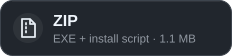
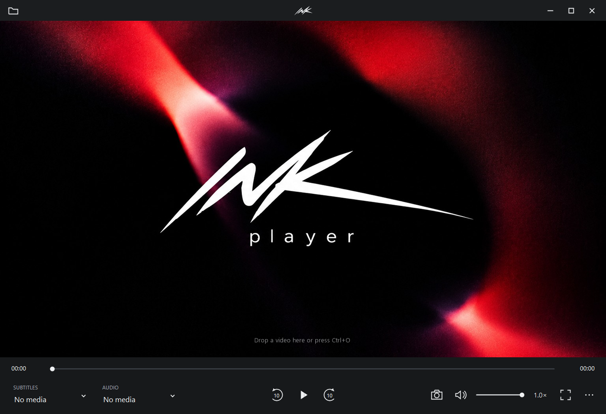

  

  
  &nbsp;
  

  Windows 10 / 11, 64-bit &nbsp;·&nbsp; Free &nbsp;·&nbsp; VLC installed automatically if missing &nbsp;·&nbsp; <a href="https://github.com/Svekolsky/InkPlayer-Releases/releases">All releases</a>

 

A quiet, dark video player for Windows on the VLC engine.

## Features

- **Resume** — position, audio and subtitle tracks are remembered per file.
- **Seamless loop** — clips up to 2 minutes repeat without a pause; one button turns it off.
- **Create subtitles** (Ctrl+T) — local speech recognition with whisper.cpp, translated into Russian.
- **Tracks at a glance** — Subtitles and Audio buttons show what's playing; add SRT / ASS / SSA / VTT / SUB.
- **Full-resolution frames** — Shift+S saves a PNG at the video's original size, even when paused.
- **Calm fullscreen** — the control bar and cursor slide away after 3 seconds.
- **Russian or English** — switch any time in *About*.

Keys

Space play / pause · ← → ±10 s (Shift: 1 min) · ↑ ↓ volume · M mute · F fullscreen · Shift+S save frame · Ctrl+O open · Ctrl+T subtitles · Ctrl+− / Ctrl++ / Ctrl+0 subtitle size

## Install

**Installer** — per-user, no admin rights; adds *Open with* for 24 formats and installs VLC if it is missing.  
**ZIP** — `InkPlayer.exe` plus a PowerShell install script (install VLC from videolan.org yourself).

## Privacy

Playback, recognition and frame capture run locally. Ink goes online only when you ask: to download the subtitle model, translate subtitles or check for updates. The installer downloads VLC from videolan.org only if it is missing. No ads, no telemetry. Checksums: **SHA256SUMS.txt** in each release.

## Author

Svekolsky — [Telegram](https://t.me/Svekolsky)
